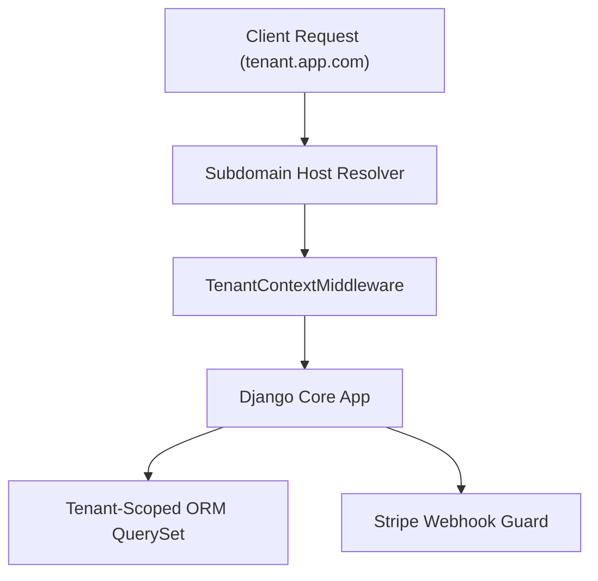

# Django Multi-Tenant SaaS Platform

[](https://github.com/FelipeMadson/django-multitenant-saas-platform/actions)
[](LICENSE)
[](https://github.com/FelipeMadson/django-multitenant-saas-platform/releases)

Enterprise multi-tenant SaaS architecture built on Python and Django 5 with subdomain-based tenant routing and strict data isolation.

## Architecture



## Key Highlights

- **Subdomain-Driven Scoping**: Host header resolution enforcing strict tenant isolation across all endpoints.
- **Tenant Lifecycle**: Clean subscription tier transitions and account suspension safeguards.
- **Pytest Automation**: 100% verified automated test suite with zero external network coupling.

## Installation & Testing

```bash
pip install -e ".[test]"
pytest -v
```

## Author

Developed by **[Felipe Madison](https://github.com/FelipeMadson)**.
