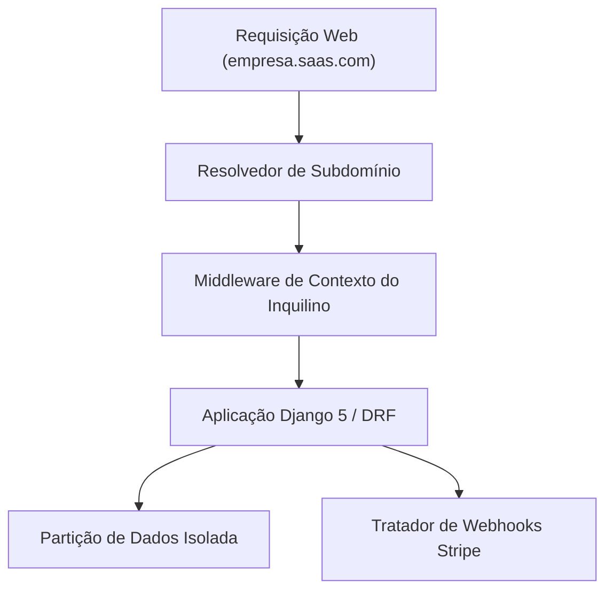

# Plataforma SaaS Multi-Tenant com Django 5

[](https://github.com/FelipeMadson/django-multitenant-saas-platform/actions)
[](LICENSE)
[](https://github.com/FelipeMadson/django-multitenant-saas-platform/releases)

Arquitetura de software SaaS corporativa multi-inquilino em Python e Django 5 com resolução de subdomínios e isolamento estrito de dados.

## Arquitetura de Sistemas



## Destaques de Engenharia

- **Isolamento por Subdomínio**: Roteamento automático baseado no cabeçalho HTTP Host para particionamento de consultas.
- **Ciclo de Vida de Inquilinos**: Suporte a planos diferenciados (Starter, Pro, Enterprise) e status ativo/inativo.
- **Suíte de Testes Pytest**: Testes automatizados com validação de invariantes e sem dependências de rede externa.

## Instalação e Testes

```bash
pip install -e ".[test]"
pytest -v
```

## Autor

Desenvolvido por **[Felipe Madison](https://github.com/FelipeMadson)**.
